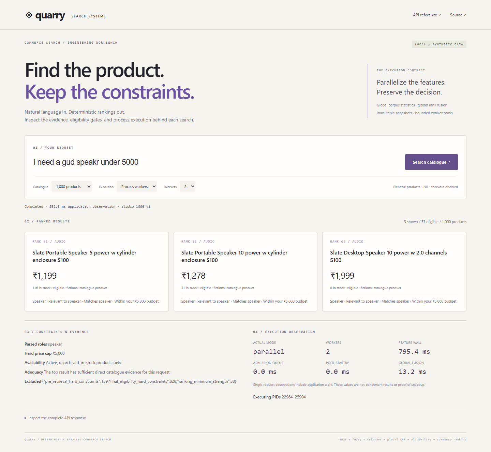

# Application screenshots

Captured from the locally running Quarry release application with actual HTTP search responses. No product photography, personal accounts, payment data or fabricated benchmark overlays are present.

## Constrained natural-language search

The submitted request is `i need a gud speakr under 5000`. The release normalizer resolves the role; results are selected from the deterministic fictional catalogue and remain subject to availability/price gates. `gud` does not represent an evaluated product-quality requirement.

## Process-worker observation

The response reports actual execution mode, worker PIDs, startup, feature wall time, admission queue and fusion observations. Values reflect a single local request. They are not a speedup comparison or production benchmark. Failure/recovery is demonstrated by automated tests rather than a fabricated UI state.
